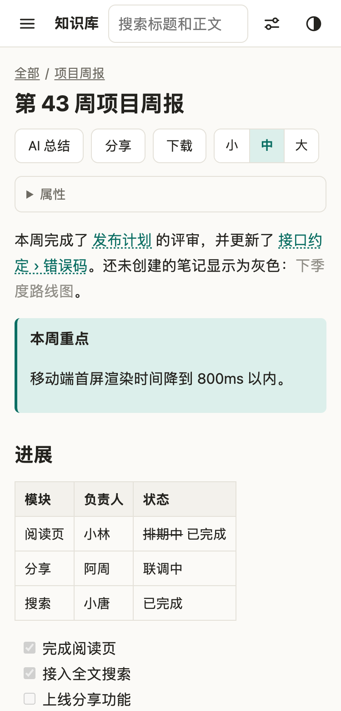
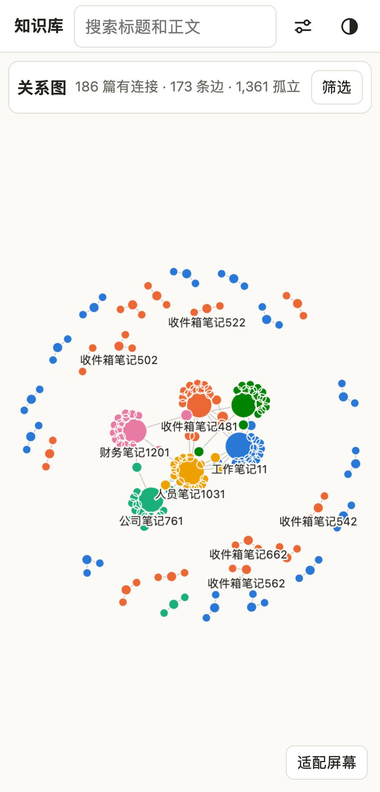
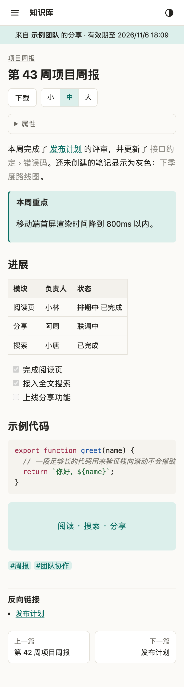
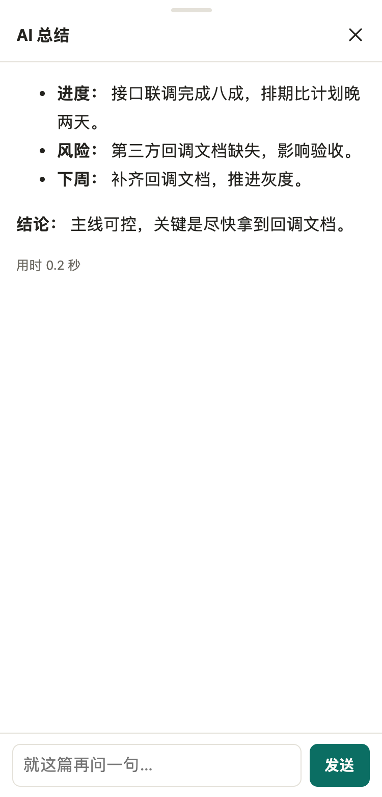

# yihu-knowledge 知识库

把一个 Markdown 笔记目录变成手机上能读、能分享、能追溯的私有网站。可以自己部署给一个人用，也可以作为以虎 One 平台的一个应用运行。

打开就能配：不用读 `.env`，浏览器里四步填完，手机上也能操作。

| 阅读页 | 关系图 | 分享页 | AI 面板 |
|---|---|---|---|
|  |  |  |  |

## 三个卖点

- **手机可读**：服务端渲染，手机优先。支持 Obsidian 风格的双链、嵌入、Callout，也能预览图片、PDF、视频、CSV 和 Office 文本。
- **可控分享与访问审计**：默认全部私有，分享必须显式创建，可设有效期和访问密码，随时撤销；谁在什么时候看了哪一篇，后台都查得到。
- **双链图谱 + AI 总结**：用 Canvas 画笔记关系；AI 一次只读当前这一篇，疑似含口令或密钥的笔记不会发出去。

## 快速开始（独立部署）

不用改任何配置文件：起服务，打开浏览器，四步填完。

**Docker：**

```bash
git clone https://github.com/guoylyy/yihu-knowledge.git && cd yihu-knowledge
docker build -t yihu-knowledge .
docker run -d --name kb -p 3030:3030 -v /你的/知识库:/library:ro -v kb-data:/data yihu-knowledge
docker logs kb | grep 设置码      # 打开 http://服务器:3030/setup 时要填，见下方「卡住了看这里」
```

向导里的知识库目录填**容器内路径** `/library`，不是你电脑上的路径。

**不用 Docker（Node 22+）：**

```bash
npm ci
npm start                         # 打开 http://localhost:3030
```

配置写进 `data/config.json`，首次索引完成后跳到登录页，不用重启。

### 卡住了看这里

- **Docker 下目录检测报「目录不存在」**：填的是宿主机路径。向导运行在容器里，只看得见 `-v` 挂进去的目录，`-v /你的/知识库:/library:ro` 对应要填 `/library`。
- **页面要「设置码」**：只有在服务器本机直接打开才免填。从别的设备、反向代理或 Docker 端口映射进来时都要填，它打印在启动日志里（`docker logs kb`）。这样服务暴露在公网时，别人不能抢在你前面配置，也不能用检测接口探测服务器目录。
- **页面提示数据目录写不进去**：Docker 用 `-v kb-data:/data` 这样的命名卷最省事。如果绑定宿主机目录（`-v ./data:/data`），它的属主必须是 UID 1000，否则先 `sudo chown 1000 ./data`。
- **没挂 `/data`**：容器重建后配置和索引都会丢，又回到向导。

### 重新配置

删除 `data/config.json`（Docker 下是 `/data/config.json`）并重启，下次访问回到向导。配置完成后 `/setup` 一律 404。换口令后，旧口令登录的会话全部失效。

### 上线到公网

向导把当时访问用的地址记作对外地址，分享链接用它生成，地址是 `http://` 时登录 cookie 不带 Secure，这样局域网里也能登录。上线前走 HTTPS 反向代理（`KB_TRUST_PROXY=1`），并设 `KB_BASE_URL=https://你的域名`，cookie 就恢复 Secure。完整步骤和「库怎么同步到服务器」见 [docs/DEPLOY-1PANEL.md](docs/DEPLOY-1PANEL.md)。

已有 `.env` 的部署不受影响：`docker compose` 固定设了 `KB_ROOT`，不会进向导。

## 平台部署（以虎 One 应用）

仓库根目录的 `yh-app.json` 是应用清单：`code` 为 `knowledge`，地址是 `<平台地址>/apps/knowledge/`，默认 `AUTH_MODE=sso`，库放在 `/data/library`，数据库放在 `/data/db`。

1. 在平台「管理 → 应用 → 从 Git 安装应用」安装本仓库（或在服务器上 `yh add` + `yh up`）。`YH_CLIENT_ID`、`YH_CLIENT_SECRET`、`YH_WEB_URL`、`YH_API_URL`、`YH_APP_URL` 由平台自动注入。
2. 决定谁能进：看应用的启动日志，白名单为空时会打出设置码。用平台账号登录一次（会看到 403），再打开 `/apps/knowledge/access?token=<设置码>`，在列表里勾上自己保存，就转成正式登录了。之后在 `/access`（后台「访问权限」）勾选其他人，保存后立即生效，不用重启。走向导部署的，在第三步直接勾选。
3. 把笔记同步到宿主机的 `apps/knowledge/data/library/`，在后台点「增量索引」，或等 30 分钟一次的自动扫描。

平台把 `/apps/knowledge/` 前缀剥掉再转发，并通过 `X-Forwarded-Prefix` 告诉应用；页面链接、跳转和 cookie 路径都会带上它，不用额外配置。

SSO 登录走平台的 OAuth2 授权码流程：`/sso/login` 跳平台授权页，平台回调 `/sso/callback`，应用校验 state、用 client 凭证换用户信息、再校验白名单，最后建立自己的会话。外部部署的应用要在平台登记回调地址 `<YH_APP_URL>/sso/callback`。

## 权限模型

一个知识库通常只属于一个人，里面没有「张三能看这个目录、李四能看那个目录」的需求，所以这里没有用户、角色和目录权限：**进得来的人看到的都一样，都是站点主人**。

| 部署方式 | `AUTH_MODE` | 怎么进 |
|---|---|---|
| 独立部署 | `password`（默认） | 一个口令。一个人部署一个人用，简单最要紧 |
| 平台部署 | `sso` | 平台账号，且在白名单里 |
| 过渡或兜底 | `both` | 两个入口都开。口令是给站点主人的，不受白名单限制 |

平台只回答「他是谁」，「他能不能进」由白名单决定。平台上的同事默认都进不来：

- 在 `/access` 从平台用户列表里勾选。最近被拒绝的登录也列在那里，点一下「加入白名单」就放行。保存写进 `config.json`，立即生效。
- 同时保存 `allowedUsers`（username）和 `allowedUserIds`（id），任一匹配即放行，平台改用户名不会失效。匹配是精确的，大小写敏感。
- 白名单为空时一律拒绝，不存在「没配置就全放行」。这时可以用启动日志里的设置码打开 `/access?token=<设置码>`：得到一个 30 分钟的临时会话，只能访问这一页，保存后结束。设置码每次启动都换，白名单有人之后不再生效，连错 5 次锁 15 分钟。
- 把人移出白名单后，他已有的会话在下一次请求时就失效。平台登录的人不能把自己移出去。
- **高级用法**：设了 `KB_ALLOWED_USERS` 后整份白名单都以它为准（填 username 或 id），`/access` 变成只读，`config.json` 里的名单不再生效，改动要重启。自动化部署时才需要；去掉它并重启就回到界面管理。
- 平台会话 8 小时过期，之后再走一次授权；所以平台上停用的账号最多再放行 8 小时。
- 每次登录和被拒绝都记在后台「访问记录」里。

要给别人看某几篇，用分享，不要加白名单。

## 配置

大多数人用向导就够了。需要脚本化部署时用环境变量，完整示例见 [.env.example](.env.example)。

**未配置的判定**：`data/config.json` 不存在，且 `KB_ROOT` 环境变量为空。此时所有页面都跳到 `/setup`。

**优先级**：环境变量 > `config.json` > 默认值，逐项判断，空字符串算没设。`/admin` 的「配置来源」列出每一项的来源。

**`config.json` 里的敏感内容**：口令只存 argon2 hash。API key 是明文，因为调用模型时要原样发出去，存 hash 没有用；文件权限 600，只有运行用户可读。这个取舍和把 key 放进 `.env` 一样，`data/` 目录本来就等同于笔记全文，备份时同样对待。不想让 key 落盘就用 `AI_API_KEY` 环境变量，向导里选「先关掉」。

### 登录

| 变量 | 默认 | 说明 |
|---|---|---|
| `AUTH_MODE` | `password` | `password` / `sso` / `both`，其他值启动失败 |
| `KB_PASSWORD` | 向导填写 | 环境变量部署时 `password`、`both` 必填，缺了启动失败。至少 8 位（向导要求至少 10 位），或直接填 argon2 hash。`sso` 时不生效 |
| `KB_ALLOWED_USERS` | 空 | 高级用法，自动化部署时用。平时在 `/access` 勾选；一旦设了，界面只读。空 = 用界面管理的名单 |

### 站点

| 变量 | 默认 | 说明 |
|---|---|---|
| `KB_ROOT` | 向导填写 | 知识库根目录，只读。设了它就不进向导 |
| `KB_DATA_DIR` | `./data` | 数据目录，放数据库和 `config.json`，里面有库内全文，权限 700，不要外传。Docker 镜像默认 `/data` |
| `KB_BASE_URL` | 向导时的访问地址，否则 `http://localhost:<端口>` | 分享链接前缀。`sso`、`both` 下缺省取 `YH_APP_URL` |
| `KB_OWNER_NAME` | 知识库主人 | 分享页署名 |
| `KB_IN_DOCKER` | 空 | 设为 `1` 时向导按容器环境提示。镜像已内置，自动识别不到时才用 |
| `KB_DENY_GLOBS` | 空 | 追加 deny 规则，`!规则` 移除默认规则 |
| `KB_TRUST_PROXY` | `0` | 反向代理层数，必须和实际一致，见下方安全边界 |
| `KB_ZIP_MAX_MB` | `1024` | 目录打包下载上限 |
| `KB_COOKIE_INSECURE` | 空 | 设为 `1` 时 cookie 不带 Secure，只用于 http 调试 |
| `PORT` | `3030` | 监听端口 |

### 以虎 One

平台托管时全部自动注入。这些变量不影响 `AUTH_MODE=password` 的登录。

| 变量 | 说明 |
|---|---|
| `YH_CLIENT_ID` / `YH_CLIENT_SECRET` | 应用凭证。缺一个时，平台登录入口禁用，登录页说明原因 |
| `YH_WEB_URL` | 平台访问地址，浏览器跳转用 |
| `YH_API_URL` | 平台接口地址，服务端换 token、调模型用 |
| `YH_APP_URL` | 本应用对外地址，回调 = 它 + `/sso/callback`。缺省取 `KB_BASE_URL` |
| `YH_BASE_PATH` | 挂载路径，只在拼「退出平台登录」地址时兜底 |

### AI

| 变量 | 默认 | 说明 |
|---|---|---|
| `AI_PROVIDER` | 自动 | `platform` / `openai` / `claude-cli` / `off`，填了就强制使用 |
| `AI_PLATFORM_MODEL` | 平台默认 | platform 通道的模型名，如 `deepseek-flash` |
| `AI_BASE_URL` | 空 | OpenAI 兼容接口地址 |
| `AI_API_KEY` | 空 | 接口密钥 |
| `AI_MODEL` | 空 | openai 通道的模型名 |
| `AI_CLI_MODEL` | 空 | claude-cli 通道的模型，留空用 CLI 默认 |
| `AI_MAX_CHARS` | `40000` | 单篇发给模型的字数上限，超出截断并在界面标注 |

`AI_PROVIDER` 留空时按这个顺序选：有 `YH_CLIENT_ID` + `YH_CLIENT_SECRET` → `platform`；有 `AI_API_KEY` → `openai`；本机有 `claude` 命令行 → `claude-cli`；都没有 → `off`。当前通道显示在 `/admin`。

这个选择和 `AUTH_MODE` 无关：环境里有 `YH_*` 时，即使是口令登录，笔记也会发给平台模型。不想这样就设 `AI_PROVIDER`。

## 安全边界

- **默认私有**：除了登录和分享链接，其余页面都要登录。
- **分享是显式的**：只有你创建的链接才对外，token 为 32 字节随机值，可设有效期、密码，可撤销，访问都有记录。
- **敏感内容三层拦截**：
  1. 路径 deny：`.env`、`*.pem`、`*密码*`、`*token*` 等命中默认规则的文件不进索引，登录后也打不开。
  2. 内容打标：正文疑似含口令或密钥的笔记会标记为敏感，不进目录分享，单篇分享要二次确认。
  3. 发送前复查：AI 调用前按标记和当前正文再扫一遍，命中就不发，索引落后于文件时也拦得住。
- **AI 只发当前一篇**：总结和追问都只带这一篇（或选中的片段），内嵌图片会被剥掉。相同内容命中本地缓存，不重复发送。模型回答按不可信内容渲染，不开 HTML 和图片。`claude-cli` 通道以 `--safe-mode --tools ""` 运行，模型没有任何工具，子进程也拿不到 `KB_*`、`AI_*`、`YH_*` 环境变量。
- **`KB_TRUST_PROXY` 要等于实际代理层数**：设大了，客户端能伪造 IP 绕过登录锁定；设小了，所有人共用一个 IP，一次爆破会把主人也锁在外面。
- **`data/` 等同于笔记本身**：里面有全文索引和 `config.json`，备份和迁移时按敏感数据对待。库目录不能包含数据目录，否则配置文件会被当成笔记索引，向导会拒绝。
- **未配置的实例不要长期暴露**：向导期间任何人都能打开 `/setup`，但提交、目录检测和平台用户列表要么来自本机，要么带启动日志里的设置码。配置完成后这组接口整体消失。

## 已知限制

- Office 文件只有文本预览，不保留版式；老格式 `.doc` / `.ppt` 不支持预览。
- 进来的人都能打开 `/access` 改白名单，没有单独的管理员角色。
- 向导只运行一次。改单项配置用环境变量，或编辑 `config.json` 后重启。
- 没有多租户：一个实例一个库，进来的人权限完全相同。
- 只读：应用不修改笔记，编辑仍在你自己的工具里做。

## 更多说明

### AI 总结与追问

阅读页点「AI 总结」。相同正文、相同问题命中 `ai_cache`，正文一变缓存自然失效。通道、模型、最近调用和命中率见 `/admin`。反向代理的读超时要大于 90 秒（AI 调用上限），否则慢请求会被代理提前掐断。

### 关系图

`/graph` 显示笔记间的双链，默认只看有连接的笔记。点节点看详情，双击或长按以它为中心看 2 跳邻域。

- **边**：`[[ ]]` 和 `![[ ]]`，同一对笔记只算一条，自己链自己不算。`[文字](路径.md)` 不画成边，但计入「被引用」。口径在 `src/graph.js` 的 `EDGE_KINDS`。
- **布局**：`public/graph-core.js` 是自写的 Barnes-Hut 力导向，无依赖、无随机数，同样的数据每次形状相同。

### 开发

```bash
npm test             # 全部测试
npm run index        # 只跑一次索引（需要 KB_ROOT 或 config.json）
npm run demo         # 生成示例库
npm run screenshots  # 重新生成截图（需要本机 Chrome）
npm run screenshots:setup  # 配置向导截图，顺带在真浏览器里走一遍完整流程
```

## License

[MIT](LICENSE)

## English TL;DR

A self-hosted, mobile-first reader for a folder of Markdown notes: Obsidian-style wiki links, a link graph, controlled sharing with access logs, and per-note AI summaries.

- **Standalone**: run `npm start` or the Docker image and open `/setup`. A four-step wizard writes `data/config.json` (mode 600) and runs the first index. Inside Docker, enter the container path (`/library`); unless you are on the server itself, the wizard asks for the setup code printed in the startup log. Delete `config.json` and restart to reconfigure. Environment variables override `config.json`, and `docker compose` deployments that set `KB_ROOT` skip the wizard.
- **On Yihu One**: `AUTH_MODE=sso`. Platform login plus an explicit allowlist, picked from the platform's user list at `/access` and effective immediately. An empty list denies everyone; the setup code in the startup log opens `/access?token=<code>` to add the first member. `KB_ALLOWED_USERS` (usernames or user ids) is for automated deployments: when set it overrides the UI, which turns read-only. `AUTH_MODE=both` enables both entry points.
- **AI**: uses the platform model when `YH_CLIENT_ID` and `YH_CLIENT_SECRET` are set, otherwise any OpenAI-compatible API, the local `claude` CLI, or off. `AI_PROVIDER` overrides the choice. Only the current note is sent, and notes that look like they contain secrets are never sent.
- **Limits**: single library per instance, no per-user permissions, the allowlist is edited by hand, Office files get text-only previews.

MIT licensed.
